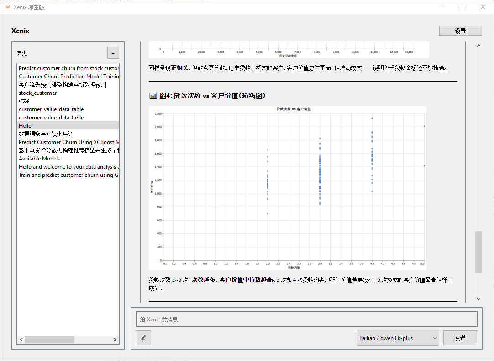
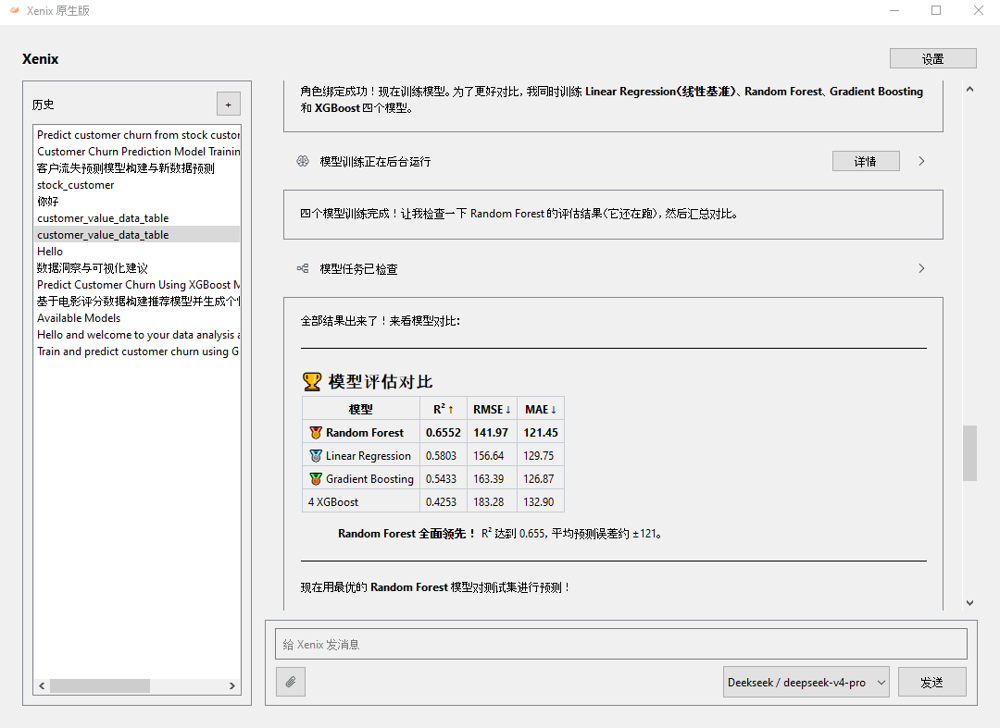

<div align="center">


<br />

**你的桌面 Data Agent，让数据分析从一句话开始。**

面向业务与市场人员，能调用工具、执行分析并交付成果的数据智能体。<br />
从一份 CSV / Excel 和一个业务问题出发，让 Agent 完成数据准备、可视化与机器学习任务。

<br />

[**产品亮点**](#产品亮点) · [**界面一览**](#界面一览) · [**技术实现**](#技术实现) · [**快速开始**](#快速开始) · [**开发文档**](docs/index.md)

<br />

`Python 3.14` &nbsp; / &nbsp; `PySide6 · Qt Widgets` &nbsp; / &nbsp; `原生机器学习` &nbsp; / &nbsp; `中文 · English`

</div>

---

## 从业务问题出发，让 Data Agent 执行分析

“哪些客户值得重点跟进？”“这次活动的表现如何？”“能否用历史数据训练一个可复用的分析模型？”

Xenix 是运行在桌面上的 Data Agent。用户在对话中附加数据、提出目标，Agent 将问题推进为实际的工具调用：检查与清洗数据、生成图表、训练和应用模型，再结合业务知识解释结果。用户可以继续追问，图表、报告和模型则作为可查看、可复用的本地产出保留下来。

> **提出问题 → Agent 调用工具 → 交付分析成果 → 继续追问**
>
> 你提出业务目标，Data Agent 执行分析任务；过程可以查看，成果可以复用。

## 产品亮点

<table>
<tr>
<td width="50%" valign="top">
<h3>01 / 对话就是工作台</h3>
<p>附加 CSV 或 Excel，用自然语言发起分析并持续追问。历史会话保留工作上下文，支持配置 LLM 提供商与模型，界面支持简体中文和英文。</p>
</td>
<td width="50%" valign="top">
<h3>02 / 从原始数据到分析素材</h3>
<p>在对话中检查、合并、清洗和准备数据，再生成摘要与可视化。处理结果注册为派生数据集，保留用户选择的原始文件。</p>
</td>
</tr>
<tr>
<td valign="top">
<h3>03 / 让模型成为可复用的工具</h3>
<p>围绕数据角色完成模型训练、调参、评估与应用。将训练好的分析模型用于兼容的新数据，让一次分析延伸为后续工作的起点。</p>
</td>
<td valign="top">
<h3>04 / 把业务知识带进分析</h3>
<p>导入文档、演示文稿、PDF 和图片，构建本地知识库。Agent 按需检索带来源定位的片段，让业务规则和已有经验参与分析；扫描件与图片可按需安装本地 OCR。</p>
</td>
</tr>
<tr>
<td valign="top">
<h3>05 / 看见结论，也看见依据</h3>
<p>在审计中心查看数据集、模型、参数、图表与报告，结合方法理由和结果解读检查分析依据。产出保存在本地，可继续打开和使用。</p>
</td>
<td valign="top">
<h3>06 / 后台任务有迹可循</h3>
<p>任务中心统一呈现知识导入、索引构建与模型任务的状态，支持查看日志和取消工作。知识任务支持重启后恢复，模型训练不会自动恢复。</p>
</td>
</tr>
</table>

**本地工作区，按需连接模型服务。** 会话、数据集、模型和正式产出由本地服务管理；对话需要配置 LLM 提供商，相关上下文会按所用功能发送给该服务。语义检索可另行配置 Embedding 服务。“本地”描述的是工作区与产出的归属，并不代表所有 AI 推理都离线完成。

## 界面一览

<div align="center">



**在对话中阅读图表，也在对话中理解结果。**

</div>

<details>
<summary><strong>展开查看：模型评估与结果对比</strong></summary>
<br />

</details>

<sub>以上图片复用仓库官网素材，拍摄于 2026 年 6 月，展示历史版本的分析流程；当前界面以实际运行版本为准。图中指标仅为该示例的输出，不代表通用模型效果。</sub>

## 技术实现

Xenix 将桌面交互、Agent 编排、数据处理、机器学习执行和本地持久化组织在同一个应用中。值得深入阅读的部分，是这些能力之间的边界与协作。

| 工程方向 | 实现与价值 | 阅读入口 |
| --- | --- | --- |
| **原生桌面与应用生命周期** | 基于 PySide6 / Qt Widgets 构建交互，由应用组合层组装服务并管理清理与退出。 | [应用组合设计](docs/30-unit-tdd/application-composition.md) |
| **Agent 与模型接入** | 分离 Agent 工作编排和 LLM 对话协议，将工具调用连接到实际业务服务。 | [Agent 服务](src/xenix/services/agent/) · [LLM 服务](src/xenix/services/llm/) |
| **数据处理与机器学习** | 结合 Polars、DuckDB、scikit-learn、XGBoost 和 LightGBM 等组件，提供数据准备与原生 ML 执行。 | [数据清洗设计](docs/30-unit-tdd/data-cleaning.md) · [ML 服务](src/xenix/services/ml/) |
| **任务生命周期与产出管理** | 后台执行与产品状态分离；本地服务持有数据集、任务、模型和正式产出的权威状态，可选 SSH worker 提供执行能力。 | [ML 任务生命周期](docs/20-prd-tdd/ml-task-lifecycle.md) · [存储边界](docs/20-prd-tdd/storage-ownership.md) |
| **分层验证与交付** | 静态检查、离线验收、Qt 界面契约、隔离桌面烟测和单独运行的真实 Agent 基准覆盖不同边界；Windows 打包采用 PyInstaller 与 Velopack。 | [贡献指南](CONTRIBUTING.md) · [打包与发布](docs/40-deployment/packaging.md) |

<details>
<summary><strong>浏览代码结构</strong></summary>

```text
src/xenix/
├── ui/                 Qt Widgets 桌面交互
├── services/
│   ├── agent/          Agent 编排与工具
│   ├── llm/            LLM 对话与提供商适配
│   ├── ml/             原生机器学习执行
│   └── storage/        本地持久化
└── resources/          品牌与界面资源

tests/                  服务验收、界面契约与 Agent 基准
scripts/                开发、诊断、验证与打包工具
native/                 原生组件
website/                独立产品官网
docs/                   产品、设计与部署文档
```

`ml/` 根目录保留历史脚本；当前原生机器学习实现位于 `src/xenix/services/ml/`。`tasks/` 保存任务过程与历史证据，当前产品和架构约定以 `docs/` 为准。

</details>

## 快速开始

准备 **Python 3.14.2** 与 **PDM 2.26.6**，在仓库根目录执行：

```powershell
pdm sync --clean -G :all
pdm run prepare
pdm run dev --isolated
```

`--isolated` 使用临时工作区，适合初次体验；需要保留日常工作时，使用 `pdm run dev` 启动持久工作区。Python 与依赖约束以 [pyproject.toml](pyproject.toml)、[pdm.lock](pdm.lock) 为准，本地环境选择见 [pdm.toml](pdm.toml)。

1. 在设置中配置 LLM 提供商、API 凭据和可用模型。
2. 新建会话并附加一份 CSV / Excel 数据。
3. 从具体问题开始，例如：“请先检查这份数据的质量，再概括值得关注的趋势。”
4. 继续追问，按需查看本地产出、审计依据与后台任务。

<details>
<summary><strong>开发验证与运行诊断</strong></summary>

```powershell
# 静态检查、离线验收与隔离桌面烟测
pdm run verify

# 聚焦一个测试文件
pdm run test tests/test_job_scheduler.py -q

# 生成本地诊断包
pdm run diagnostic-bundle
```

更多测试、翻译、打包与发布命令见 [贡献指南](CONTRIBUTING.md)。工作区路径、状态持久化和恢复方式见 [运行状态](docs/40-deployment/runtime-state.md)。

</details>

## 继续探索

| 想了解什么 | 从这里开始 |
| --- | --- |
| 产品面向谁，支持哪些工作流 | [产品定义与能力范围](docs/10-prd/README.md) |
| 模块如何协作，数据归谁管理 | [跨模块技术设计](docs/20-prd-tdd/README.md) |
| 各组件如何实现，为什么这样设计 | [组件设计](docs/30-unit-tdd/README.md) |
| 如何打包、部署、诊断与恢复 | [部署文档](docs/40-deployment/README.md) |
| 如何参与开发 | [贡献指南](CONTRIBUTING.md) · [仓库工作约定](AGENTS.md) |

---

<div align="center">

**Xenix Native · 你的桌面 Data Agent。**

基于 [GNU GPL v3](LICENSE) 许可发布。

</div>
